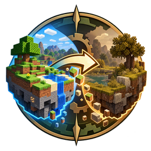
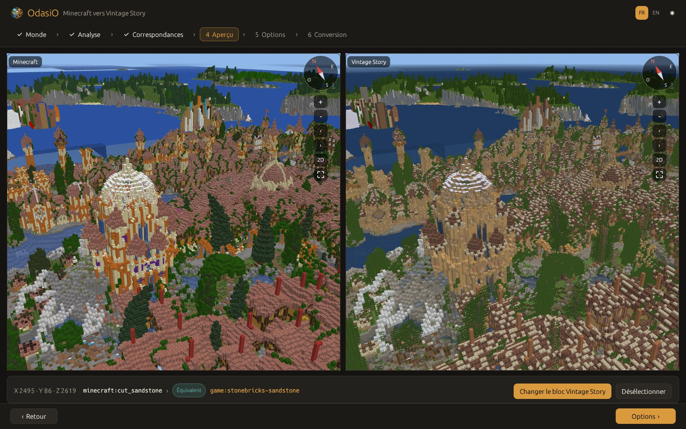
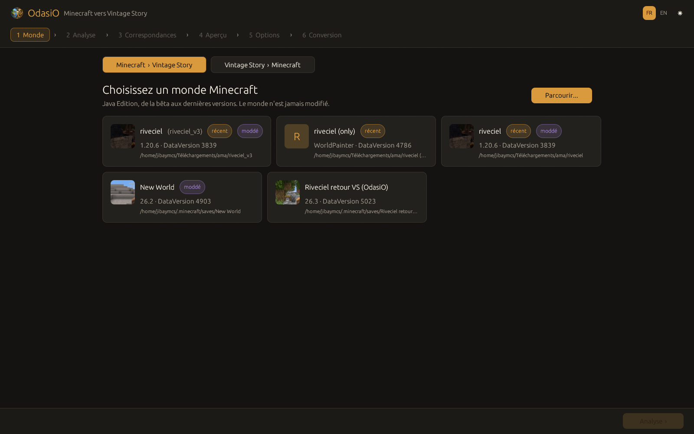
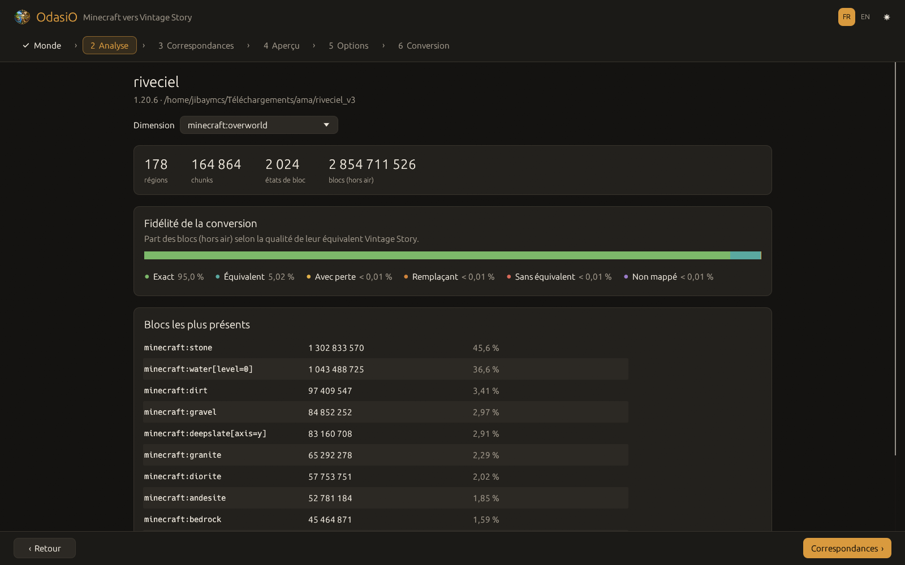
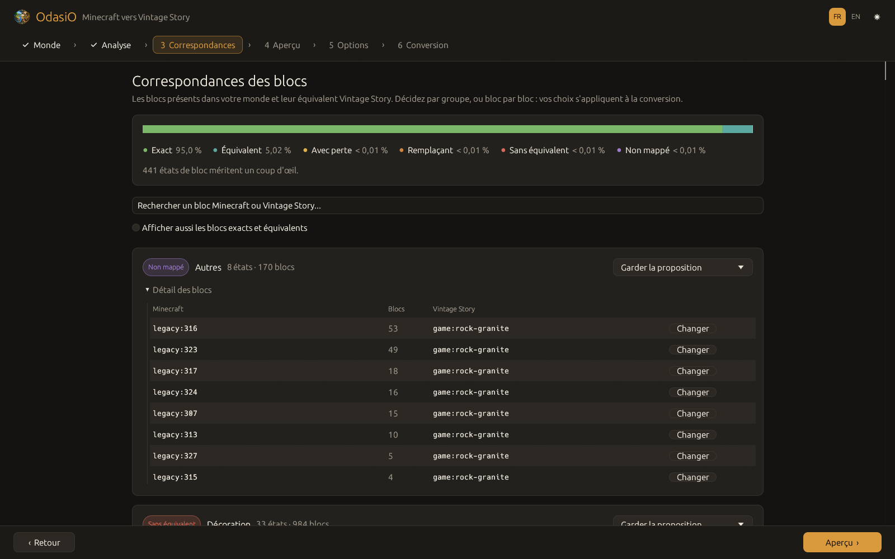
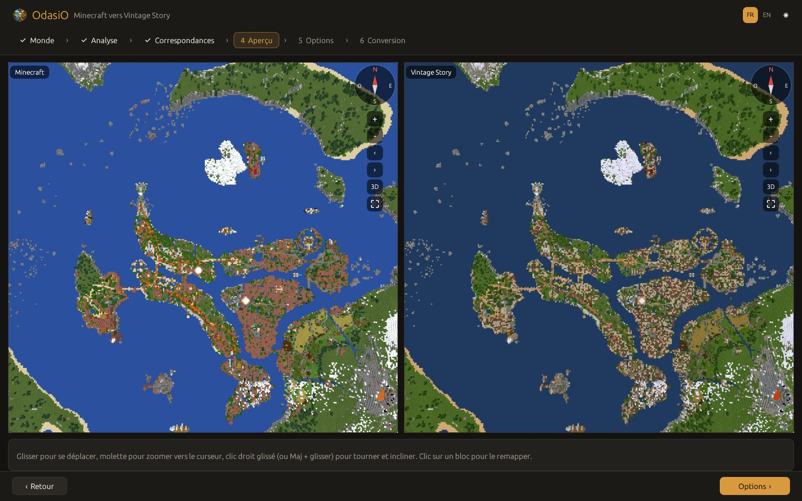
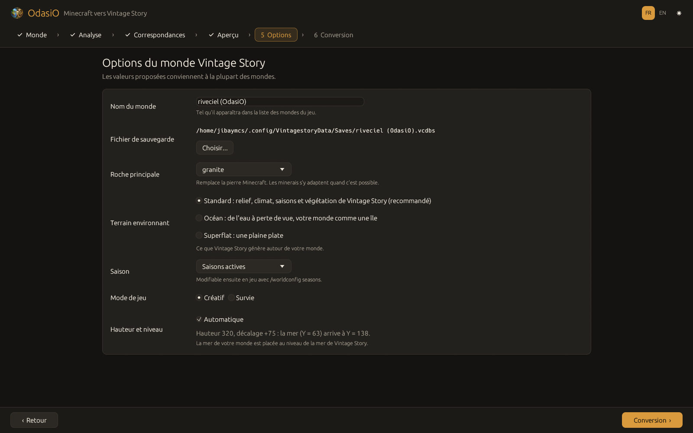

<p align="center">
  
</p>

<h1 align="center">OdasiO</h1>

<p align="center">
  <strong>Convertissez vos mondes Minecraft en mondes Vintage Story, et inversement.</strong><br>
  Application de bureau et ligne de commande, rapide, libre, écrite en Rust.
</p>

<p align="center">
  <a href="LICENSE-MIT"></a>
  
  
  
  
</p>

<p align="center">
  <a href="README.md">English</a> · <strong>Français</strong>
</p>

<p align="center">
  
</p>

OdasiO transforme un monde Minecraft Java en monde Vintage Story jouable immédiatement : relief, constructions, panneaux, portes, coffres, éclairage, tout y est. Presque chaque bloc a son équivalent dans Vintage Story : une table de correspondances pré-remplie d'environ 2 800 règles couvre Minecraft vanilla, et vous décidez du sort du reste.

Avant de convertir, vous pouvez survoler **les deux mondes côte à côte en 3D**, rendus avec les textures et les modèles des jeux installés sur votre ordinateur, et remapper n'importe quel bloc d'un clic.

## Fonctionnalités

- **Minecraft vers Vintage Story**, des mondes Java bêta aux dernières versions (identifiants numériques d'avant 1.13, 1.13 à 1.17, 1.18 et plus, et les versions 26.x).
- **Vintage Story vers Minecraft** : transformez une sauvegarde Vintage Story en monde Minecraft Java.
- **Correspondances pré-remplies** : chaque bloc est noté (*exact*, *équivalent*, *avec perte*, *remplaçant*, *sans équivalent*, *non mappé*) et classé par catégorie. Gardez la proposition, remplacez tout un groupe par de l'air ou par le bloc de votre choix, ou changez un seul bloc.
- **Aperçu 3D libre** des deux mondes avec une caméra partagée : vue d'ensemble de tout le monde, zoom vers le curseur, rotation et inclinaison libres, boussole. De loin, le relief vient d'une carte du monde ; de près, les chunks autour de vous se chargent en tâche de fond, bloc par bloc, avec les formes détaillées (escaliers, barrières, portes...).
- **Remappage en direct** : cliquez sur un bloc de l'aperçu, choisissez son remplaçant Vintage Story, et le côté Vintage Story se met à jour aussitôt.
- **Résultat jouable** : block entities (panneaux avec leur texte, portes, trappes, coffres, lanternes, terres labourées, ruches, pousses...), orientations, blocs immergés et liquides, et éclairage calculé par OdasiO pour un monde correct dès le premier chargement.
- **Le monde autour de votre carte** : terrain de Vintage Story (niveaux de la mer alignés), océan à perte de vue, ou plaine plate. Choisissez la saison (ou bloquez-la) et le mode de jeu.
- **Vos fichiers ne risquent rien** : le monde d'origine est seulement lu, jamais modifié.
- **Aucun téléchargement** : textures et modèles sont lus dans vos installations de Minecraft et de Vintage Story. Rien des jeux n'est inclus ni redistribué.
- **Interface en français et en anglais**, thèmes clair et sombre.
- **Rapide** : un monde de 160 000 chunks est analysé en 2 secondes environ et converti en moins d'une minute.

## Captures

| | |
|---|---|
|  |  |
| **1. Choisir un monde.** Les mondes récents et installés sont listés. | **2. Analyse.** Ce que contient le monde et la fidélité de la conversion. |
|  |  |
| **3. Correspondances.** Décidez du sort des blocs à vérifier. | **4. Aperçu.** Les deux mondes en 3D, de la carte entière jusqu'au bloc. |
|  |  |
| **5. Options.** Nom, roche, terrain environnant, saison, mode de jeu. | Cliquez sur un bloc pour voir sa conversion et la changer. |

## Pour commencer

1. Installez **Vintage Story 1.22** (nécessaire pour créer le monde converti) et, pour les textures de l'aperçu, **Minecraft Java Edition**.
2. Téléchargez OdasiO depuis la page [Releases](https://github.com/JibayMcs/OdasiO/releases) : paquet `.deb` pour Debian et Ubuntu, installateur `.exe` pour Windows. Vous pouvez aussi [le compiler vous-même](docs/wiki/fr/installation.md#compiler-depuis-les-sources).
3. Lancez **OdasiO**, choisissez votre monde Minecraft, suivez les six étapes, puis ouvrez le nouveau monde depuis la liste des mondes de Vintage Story.

Plutôt terminal ?

```sh
odasio scan  ~/.minecraft/saves/MonMonde          # ce que contient le monde
odasio plan  ~/.minecraft/saves/MonMonde          # ce que deviendra chaque bloc
odasio convert ~/.minecraft/saves/MonMonde --name "Mon monde" --world-type standard
```

## Documentation

Le wiki détaille tout :

- [Installation](docs/wiki/fr/installation.md) : paquets, prérequis, compilation
- [Guide d'utilisation](docs/wiki/fr/guide.md) : chaque étape de l'application, les commandes de l'aperçu 3D, la conversion vers Minecraft
- [Ligne de commande](docs/wiki/fr/cli.md) : toutes les commandes et options, avec des exemples
- [Correspondances des blocs](docs/wiki/fr/correspondances.md) : notes, catégories, choix, et comment améliorer la table
- [FAQ et dépannage](docs/wiki/fr/faq.md)
- [Fonctionnement](docs/wiki/fr/fonctionnement.md) : la chaîne de conversion et les notes techniques

## Compiler depuis les sources

Il faut [Rust](https://rustup.rs) 1.85 ou plus récent.

```sh
git clone https://github.com/JibayMcs/OdasiO.git
cd OdasiO
cargo build --release
./target/release/odasio-gui      # application de bureau
./target/release/odasio --help   # ligne de commande
```

Sous Linux, quelques bibliothèques système sont nécessaires pour la fenêtre : voir [Installation](docs/wiki/fr/installation.md#compiler-depuis-les-sources).

## Organisation du projet

| Crate | Rôle |
|---|---|
| `odasio-mc` | Lecture et écriture des mondes Minecraft (`level.dat`, régions Anvil, NBT, tous les formats de chunks) |
| `odasio-vs` | Lecture et écriture des sauvegardes Vintage Story (`.vcdbs`, SQLite, couches de chunks, éclairage, block entities) |
| `odasio-core` | Correspondances des blocs, plans de conversion et chaînes de conversion dans les deux sens |
| `odasio-render` | Lecture des textures et modèles des jeux ; maillages et carte pour l'aperçu |
| `odasio-gui` | Application de bureau (egui, wgpu) |
| `odasio-cli` | Ligne de commande (`odasio`) |

## Contribuer

Les signalements de bugs, corrections de correspondances et pull requests sont les bienvenus. Le plus simple pour aider : signaler un bloc mal converti, en ouvrant une issue avec le bloc Minecraft, ce que vous avez obtenu dans Vintage Story et ce que vous attendiez. La table vit dans [`assets/mapping.toml`](assets/mapping.toml) et est décrite dans [Correspondances des blocs](docs/wiki/fr/correspondances.md).

Avant d'envoyer une pull request, lancez `cargo fmt`, `cargo clippy --workspace --all-targets` et `cargo test --workspace`.

## Licence

OdasiO est libre et open source, au choix sous :

- licence MIT ([LICENSE-MIT](LICENSE-MIT))
- licence Apache 2.0 ([LICENSE-APACHE](LICENSE-APACHE))

OdasiO est un projet de fan. Il n'est ni affilié à Mojang Studios, Microsoft ou Anego Studios, ni approuvé par eux. Minecraft est une marque de Mojang Synergies AB ; Vintage Story est une marque d'Anego Studios. Aucune ressource des jeux n'est distribuée avec OdasiO : textures et modèles sont lus dans vos propres installations au moment de l'utilisation.
