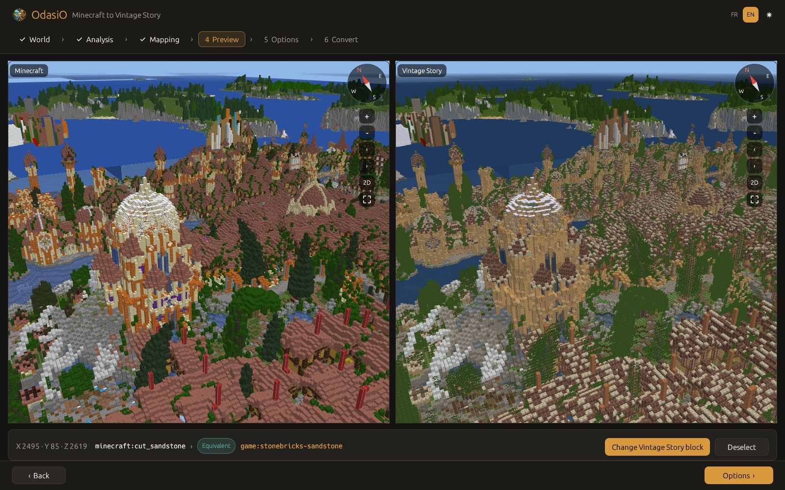
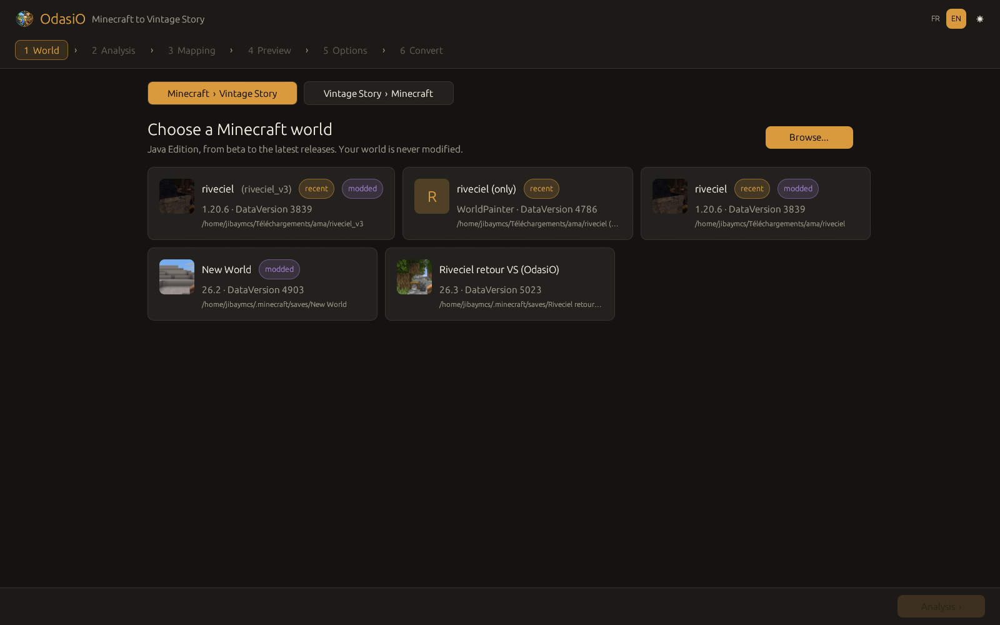
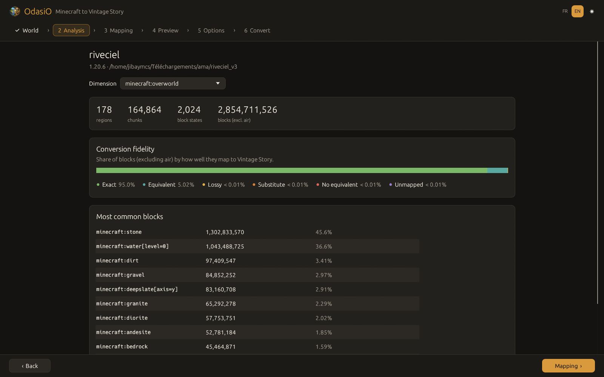
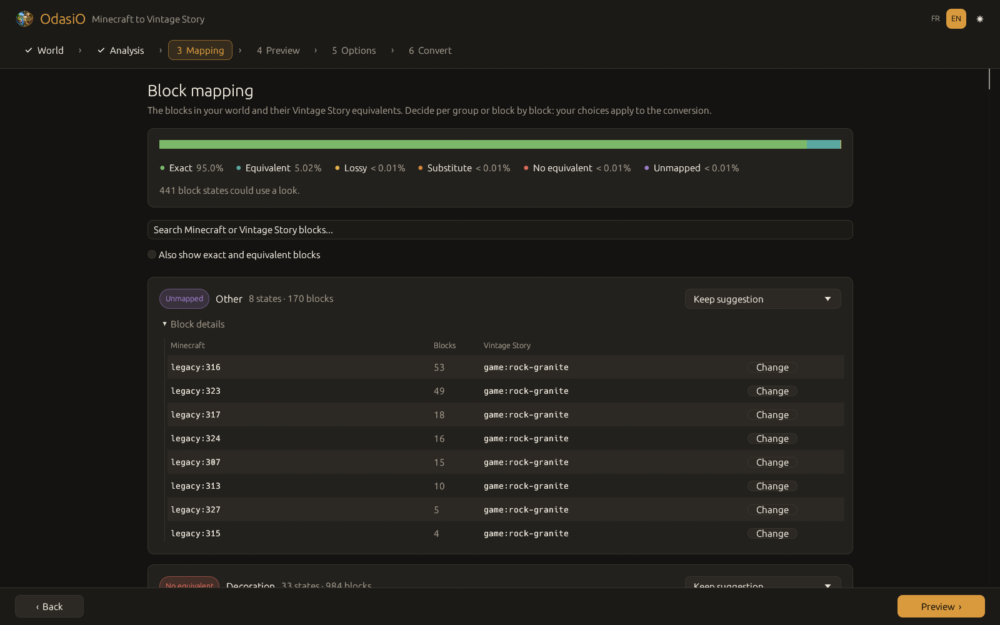
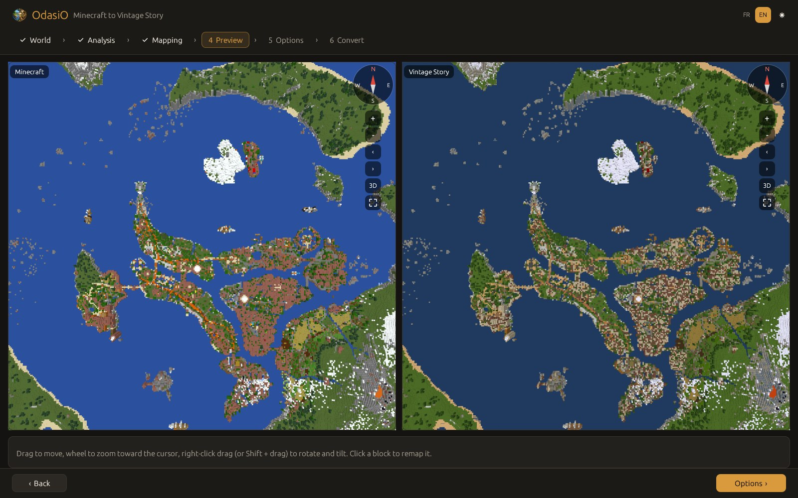
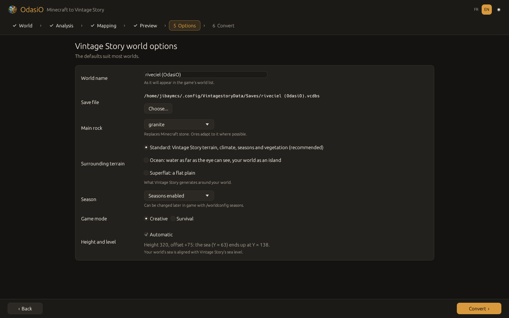

<p align="center">
  
</p>

<h1 align="center">OdasiO</h1>

<p align="center">
  <strong>Convert your Minecraft worlds to Vintage Story, and back.</strong><br>
  Desktop app and command line, fast, open source, built in Rust.
</p>

<p align="center">
  <a href="LICENSE-MIT"></a>
  
  
  
  
</p>

<p align="center">
  <strong>English</strong> · <a href="README.fr.md">Français</a>
</p>

<p align="center">
  
</p>

OdasiO turns a Minecraft Java world into a Vintage Story world you can open and play right away: terrain, buildings, signs, doors, chests, lighting and all. Nearly every block has a Vintage Story counterpart: a pre-filled mapping of about 2,800 rules covers vanilla Minecraft, and you decide what happens to the rest.

Before converting, you can fly over **both worlds side by side in 3D**, rendered with the textures and models of the games installed on your computer, and remap any block with a click.

## Features

- **Minecraft to Vintage Story**, from Java beta worlds to the latest releases (pre-1.13 numeric ids, 1.13 to 1.17, 1.18+ and the 26.x versions).
- **Vintage Story to Minecraft**: turn a Vintage Story save into a Minecraft Java world.
- **Pre-filled block mapping**: every block is rated (*exact*, *equivalent*, *lossy*, *substitute*, *no equivalent*, *unmapped*) and grouped by category. Keep the suggestion, replace a whole group with air or any block of your choice, or override a single block.
- **Free 3D preview** of both worlds with a shared camera: overview of the whole world, zoom toward the cursor, free rotation and tilt, compass. Far away the terrain comes from a map of the world; up close, the chunks around you load in the background, block by block, with detailed shapes (stairs, fences, doors...).
- **Live remapping**: click a block in the preview, pick its Vintage Story replacement, and the Vintage Story side updates immediately.
- **Playable result**: block entities (signs with their text, doors, trapdoors, chests, lanterns, farmland, beehives, saplings...), rotations, waterlogged blocks and liquids, and lighting computed by OdasiO so the world looks right on first load.
- **Choose the world around your map**: Vintage Story terrain (sea levels aligned), endless ocean, or a flat plain. Pick the season (or lock it) and the game mode.
- **Your files are safe**: the source world is only read, never modified.
- **No downloads**: textures and models are read from your Minecraft and Vintage Story installations. Nothing from the games is bundled or redistributed.
- **English and French** interface, light and dark themes.
- **Fast**: a 160,000-chunk world is analysed in about 2 seconds and converted in under a minute.

## Screenshots

| | |
|---|---|
|  |  |
| **1. Pick a world.** Recent and installed worlds are listed. | **2. Analysis.** What the world contains and how well it converts. |
|  |  |
| **3. Mapping.** Decide what happens to the blocks that need a look. | **4. Preview.** Both worlds in 3D, from the whole map down to single blocks. |
|  |  |
| **5. Options.** Name, rock, surrounding terrain, season, game mode. | Click any block to see how it converts and change it. |

## Getting started

1. Install **Vintage Story 1.22** (needed to create the converted world) and, for the textures of the preview, **Minecraft Java Edition**.
2. Download OdasiO from the [Releases](https://github.com/JibayMcs/OdasiO/releases) page: `.deb` package for Debian and Ubuntu, `.exe` installer for Windows. You can also [build it from source](docs/wiki/en/installation.md#build-from-source).
3. Launch **OdasiO**, pick your Minecraft world, follow the six steps, and open the new world from Vintage Story's world list.

Prefer the terminal?

```sh
odasio scan  ~/.minecraft/saves/MyWorld          # what the world contains
odasio plan  ~/.minecraft/saves/MyWorld          # what each block will become
odasio convert ~/.minecraft/saves/MyWorld --name "My world" --world-type standard
```

## Documentation

The wiki covers everything in detail:

- [Installation](docs/wiki/en/installation.md): packages, requirements, building from source
- [User guide](docs/wiki/en/user-guide.md): every step of the app, the 3D preview controls, converting back to Minecraft
- [Command line](docs/wiki/en/cli.md): all commands and options, with examples
- [Block mapping](docs/wiki/en/block-mapping.md): ratings, categories, choices, and how to improve the mapping
- [FAQ and troubleshooting](docs/wiki/en/faq.md)
- [How it works](docs/wiki/en/how-it-works.md): the conversion pipeline and the technical notes

## Building from source

You need [Rust](https://rustup.rs) 1.85 or newer.

```sh
git clone https://github.com/JibayMcs/OdasiO.git
cd OdasiO
cargo build --release
./target/release/odasio-gui      # desktop app
./target/release/odasio --help   # command line
```

On Linux, a few system libraries are needed for the window; see [Installation](docs/wiki/en/installation.md#build-from-source).

## Project layout

| Crate | Role |
|---|---|
| `odasio-mc` | Reads and writes Minecraft worlds (`level.dat`, Anvil regions, NBT, every chunk format) |
| `odasio-vs` | Reads and writes Vintage Story saves (`.vcdbs`, SQLite, chunk layers, lighting, block entities) |
| `odasio-core` | Block mapping, conversion plans and the conversion pipelines in both directions |
| `odasio-render` | Reads the games' textures and models; meshing and map building for the preview |
| `odasio-gui` | Desktop app (egui, wgpu) |
| `odasio-cli` | Command line (`odasio`) |

## Contributing

Bug reports, mapping fixes and pull requests are welcome. The easiest way to help is to report a block that converts badly: open an issue with the Minecraft block, what you got in Vintage Story and what you expected. The mapping lives in [`assets/mapping.toml`](assets/mapping.toml) and is documented in [Block mapping](docs/wiki/en/block-mapping.md).

Before sending a pull request, please run `cargo fmt`, `cargo clippy --workspace --all-targets` and `cargo test --workspace`.

## License

OdasiO is free and open source, available under either of:

- MIT license ([LICENSE-MIT](LICENSE-MIT))
- Apache License 2.0 ([LICENSE-APACHE](LICENSE-APACHE))

at your option.

OdasiO is a fan project. It is not affiliated with or endorsed by Mojang Studios, Microsoft or Anego Studios. Minecraft is a trademark of Mojang Synergies AB; Vintage Story is a trademark of Anego Studios. No game assets are distributed with OdasiO: textures and models are read from your own installations at runtime.
